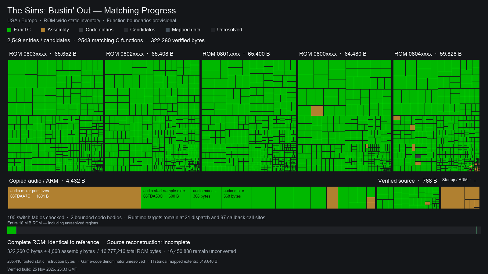

# The Sims: Bustin' Out

A matching decompilation of *The Sims: Bustin' Out* for the Game Boy Advance,
targeting the multilingual USA/Europe release and its USA revision 1.

This is an **AI-driven experiment** to see what coding agents can do.
Almost all code, analysis and tooling are AI-generated.

## Progress



Green tiles are matching C. Function boundaries in the
[ROM map](assets/rom-inventory.json) are provisional.
Amber tiles are verified hardware glue and routines with evidence of assembly
origin, counted separately from C.
The build matches the original ROM, but most regions are still copied from
the original dump.
The ROM map separately records rooted static instructions, estimated extents,
data and unresolved regions. It does not yet establish a complete game-code
denominator. The historical 319,640 mapped extent bytes remain a fixed comparison.
A source-owned extent can still lack an established incoming call; source
ownership and reachability are separate claims.
The [verified progress data](assets/progress.json) records source ownership for
known RAM copies and counts overlapping ROM bytes once.
Local evidence retains the current verified build and a bounded set of useful
failures. Historical receipts do not imply that older raw artifacts remain
available for revalidation.

## The case of the missing store

Exactly one mapped routine has no source owner: the 124-byte audio
master-volume function at `0x08049968`. Our best C matches 122 of its bytes.
The other two are a single instruction, and we are fairly sure no C source
ever produced it. Here is the detective story.

**The suspect.** The function is `kramSetMasterVol` from
[Krawall](https://github.com/sebknzl/krawall/tree/8d338581bf0ed0afad15b66bf5979ad4c4d15ed0),
Sebastian Kienzl's sound library, which the game uses for its audio. It fills
a clipping table centred on its base address: indices −1023 to 1023 in a loop,
then one last byte at index −1024.

**The compiler trips.** Write that last store as `table[-1024] = ...` and
[GCC 3.0.2](https://ftp.gnu.org/gnu/gcc/gcc-3.0.2/) falls over, but only when
the compiler itself runs on a 32-bit machine. The bit offset −8192 gets
[treated as unsigned](https://github.com/gcc-mirror/gcc/blob/releases/gcc-3.0.2/gcc/expmed.c#L233)
before being divided by eight, so −1024 comes out as `0x1FFFFC00`. The store
would land at `0x22000E38`, which is nowhere near the table, or near anything
else. Our [pinned compiler](config/gcc302-hwi32-toolchain.json) reproduces
the bug, and the same bad constant is sitting in the original ROM's literal
pool. So far, so explicable.

**The store vanishes.** The original code loads the table address, loads the
bad constant, adds them, works out the value to write... and then does
nothing at all:

| Address | Original ROM | Our C |
| --- | --- | --- |
| `0x080499B0` | `mov r8, r8` | `strb r2, [r1]` |

That is not how compilers behave. An optimiser that drops a store also drops
the sums feeding it; it does not carefully compute an address and a value and
then shrug. We went through the tools looking for anything that could plant
that no-op. GCC 3.0.2 has
[one no-op emitter](https://github.com/gcc-mirror/gcc/blob/releases/gcc-3.0.2/gcc/stmt.c#L653-L664),
and it only fires in unoptimised builds. The
[`nop` pattern](https://github.com/gcc-mirror/gcc/blob/releases/gcc-3.0.2/gcc/config/arm/arm.md#L6920-L6926)
is where the `mov r8, r8` spelling comes from, but nothing optimised reaches
it. The [assembler](https://ftp.gnu.org/gnu/binutils/) emits that encoding
only for a literal `nop`, and the linker only inside interworking stubs.

**The confession, sort of.** The public Krawall source
[writes the statement as `table[-i]`](https://github.com/sebknzl/krawall/blob/8d338581bf0ed0afad15b66bf5979ad4c4d15ed0/lib/mixer.c#L106-L107),
where `i` happens to be 1024 once the loop ends, under a comment noting that
`[-1024]` "makes GCC 3.0.2 generate an invalid constant". The
[USA revision 1 ROM](config/targets/us-rev1.json) ships that version: 116
bytes at `0x08049A4C`, no bad constant, a real store. Compile the `[-i]` form
with our pinned compiler and flags and all 116 bytes drop out.

**Our theory.** Someone spotted the stray write and, as a stopgap, blanked
out that one instruction in the already-compiled library. The source got its
proper fix later, in time for revision 1. The compiler bug, the no-op and the
revision 1 match are established. Who removed the store, and how, is our
inference: no build artefact from the time shows it, and a post-processing
script would fit just as well.

So the routine stays unowned, listed in the [triage table](docs/TRIAGE.md).
We could make the bytes match by patching the compiler's output, but then it
would not be a decompilation.

## Building

Requires macOS, Python 3.10+ and Xcode's command line tools.

Run once from the repository root:

```sh
make setup
```

Put your USA/Europe ROM here:

```text
baseroms/Sims, The - Bustin' Out (USA, Europe) (En,Fr,De,Es,It,Nl).gba
```

SHA-1: `fb5662172fadebf4577f6f6f163741fc041c11e6` (16 MiB).

```sh
make build
```

Output: `build/us-eu/bustin-out.gba`. The build fails if any byte differs.

For revision 1, put this ROM alongside it and build with `TARGET=us-rev1`:

```text
baseroms/Sims, The - Bustin' Out (USA) (En,Fr,De,Es,It,Nl) (Rev 1).gba
```

SHA-1: `7038fa0e4cb8aeac9e48a0b45574db66cba39e73` (16 MiB).

```sh
make build TARGET=us-rev1
```

Revision 1 shares the C sources. `make port` derives its
[manifest](config/build-us-rev1.json) from the revision 0 one, carrying over
only functions whose bytes differ solely in relocated addresses. The revision 1
build currently matches with 2,511 C functions; the progress treemap covers
revision 0 only.

| Command | Purpose |
| --- | --- |
| `make test` | Run tests; no ROM needed. |
| `make progress` | Rebuild and update the treemap. |
| `make audit-all` | Check both the USA/Europe and USA revision 1 dumps. |

The generated [triage table](docs/TRIAGE.md) records remaining mapped rows and
retained candidate scores. `make progress` refreshes it. Optional local search
uses the separate search environment:
`toolchains/search-venv/bin/python tools/permuter_setup.py --help`.
Search output must pass the normal matching and changed-source controls before
acceptance.

## Repository

```text
.
├── Makefile        Build commands
├── assets/         Progress image and ROM map
├── config/         ROM hashes, tool versions and mapped regions
├── include/        C headers
├── src/            Matching C and justified assembly
├── tools/          Build and analysis scripts
├── tests/          Tests
└── docs/           Internal AI scratch notes
```

## About

This project does not accept contributions, pull requests, issues or support
requests. ROMs, extracted assets and game binaries are not included.

## Licence and credits

The [MIT licence](LICENSE.md) covers our own contributions to the source, tools
and documentation. It does not cover original game code, assets or trademarks,
Nintendo's ROM header logo, or third-party material.

### Original game

*The Sims: Bustin' Out* for Game Boy Advance was developed by Griptonite Games
with EA's Maxis studio and published by Electronic Arts. See the
[GBA credits](https://www.mobygames.com/game/11215/the-sims-bustin-out/credits/gameboy-advance/) for the original development team.

This is an unofficial project, unaffiliated with the original developers,
publisher or Nintendo.

### Tools and dependencies

Dependencies are installed separately under their own licences. The table lists
their main licences; bundled components retain their upstream notices.
Pinned versions are recorded in [config/](config/).
The adapted audio routines, assembly-origin mixer primitives, hardware timer IRQ
and BIOS division wrapper retain their [Krawall licence](licenses/Krawall-LGPL-2.1.txt)
and source notices.
The selected floating-point, integer and register-call runtime sources retain their GNU GCC
notices and [GPL licence](licenses/GCC-GPL-2.0.txt), including the exceptions
printed in those source files.
The adapted Newlib string providers retain their [upstream notices](licenses/Newlib-COPYING.txt).
They include software developed by the University of California, Berkeley.
The independently reconstructed background decoder has documented
[assembly-origin evidence and version limits](docs/RESOURCE_BACKGROUND_DECODER.md).

| Dependency | Use | Licence |
| --- | --- | --- |
| [pret/agbcc](https://github.com/pret/agbcc/tree/da598c1d918402c42c0c0d7128ba14567f3175e9), based on GNU GCC | Matching C compiler | GPL-2.0-or-later |
| [GNU GCC](https://ftp.gnu.org/gnu/gcc/gcc-3.0.2/) 3.0.2 | Selected ARM/Thumb matching C compiler | GPL-2.0-or-later |
| [GNU Binutils](https://www.gnu.org/software/binutils/) 2.43.1 | Assembler, linker and binary conversion | GPL-3.0-or-later |
| [GNU Binutils](https://ftp.gnu.org/gnu/binutils/) 2.10.1 | Selected assembler for earlier alignment behavior | GPL-2.0-or-later |
| [Capstone](https://www.capstone-engine.org/) 5.0.7, by Nguyen Anh Quynh and contributors | Disassembly | BSD-3-Clause |
| [pyelftools](https://github.com/eliben/pyelftools) 0.32, by Eli Bendersky and contributors | ELF inspection | Unlicense/public-domain dedication |
| [Pillow](https://python-pillow.github.io/) 12.3.0, by Alex Clark and contributors, based on PIL | Progress images | MIT-CMU |
| [Krawall](https://github.com/sebknzl/krawall/tree/8d338581bf0ed0afad15b66bf5979ad4c4d15ed0), by Sebastian Kienzl | Selected audio routines and BIOS division wrapper | LGPL-2.1-or-later |
| [mGBA](https://github.com/mgba-emu/mgba/tree/26b7884bc25a5933960f3cdcd98bac1ae14d42e2) 0.10.5 | Optional bounded runtime observations | MPL-2.0 and bundled notices |

The selected historical tools use documented [host compatibility patches](tools/patches/README.md)
under their respective upstream licences. Their selection does not establish
the historical game's toolchain.

### References and inspiration

- [Tonc](https://gbadev.net/tonc/), by Jasper Vijn and contributors, for GBA hardware documentation, including interrupts.
- [No-Intro](https://no-intro.org/), via [libretro's database](https://github.com/libretro/libretro-database/blob/master/metadat/no-intro/Nintendo%20-%20Game%20Boy%20Advance.dat), for ROM identity checks.
- [TsilaAllaoui/warioland4](https://github.com/TsilaAllaoui/warioland4) and [722rsr/gtadv3-decomp](https://github.com/722rsr/gtadv3-decomp).
